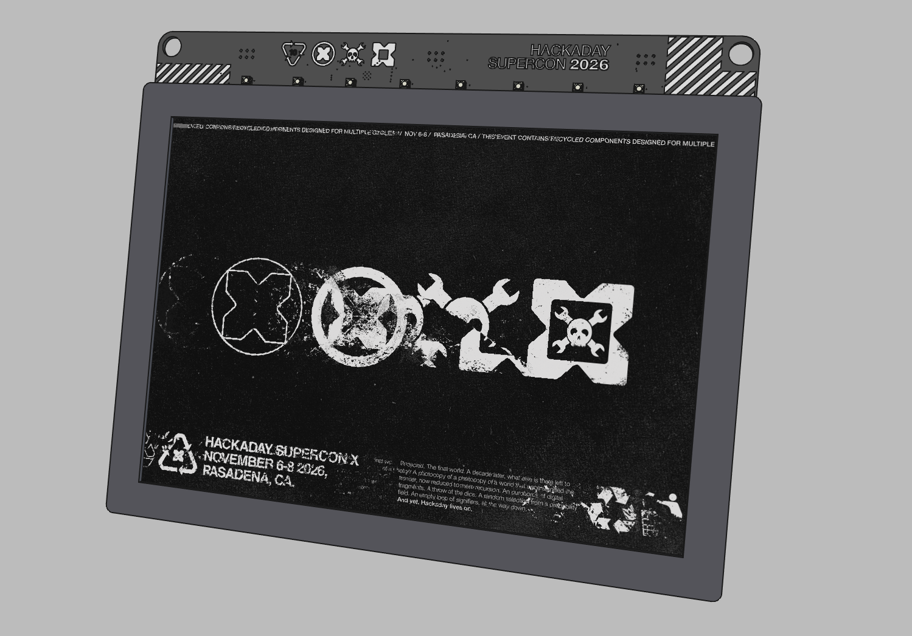

## Pins

The board only has two truly free GPIOs

* GPIO9
* GPIO41

The SAO ports, however, have many possibilities

* SAO1: GPIO2 and GPIO42
* SAO2: GPIO4 and GPIO5
* SAO3: GPIO7 and GPIO6
* I2C bus: SDA on GPIO17 and SCL on GPIO18

The row of WS2812-compatible LEDs is on GPIO38

Buttons are

* Menu +/-: GPIO40 / GPIO15
* User A/B: GPIO39 / GPIO15  
